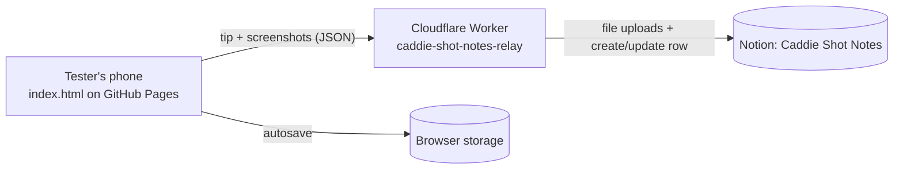

# Caddie Shot Notes

A mobile-first sheet for golfers testing the Hole19 caddie: rate each tip (1 to 5 stars), add a note and screenshots, then tap **Send to Hole19**. Each tip lands as one row in the Notion database "Caddie Shot Notes".

## How it fits together

- `index.html`: the page. Saves in the tester's browser; Send posts each new or changed tip to the relay. Re-sending updates the same Notion row (matched on Round ID + Tip #); deleted tips are moved to Notion's trash.
- `worker/`: the relay. Holds the Notion token, only accepts posts from the origins in `ALLOWED_ORIGINS`.

## Setup (one-off)

1. Notion: create an internal integration at notion.so/profile/integrations, copy its secret, then on the "Caddie Shot Notes" database use ••• > Connections > add the integration.
2. Cloudflare: `cd worker && npx wrangler login && npx wrangler deploy`, then `npx wrangler secret put NOTION_TOKEN` and paste the secret.
3. Put the Worker URL into `RELAY_URL` in `index.html` and push.

The token lives only in Cloudflare. Never commit it.
